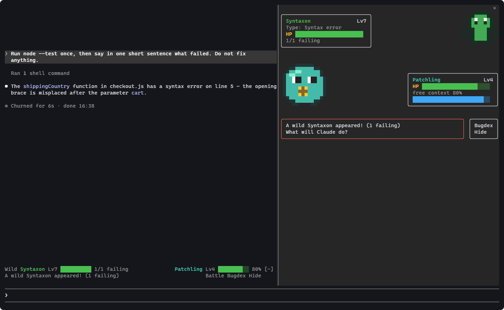
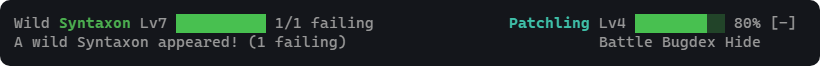
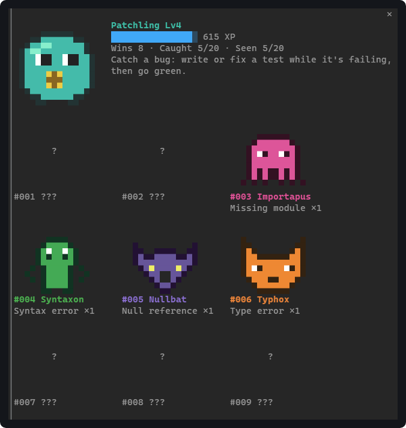
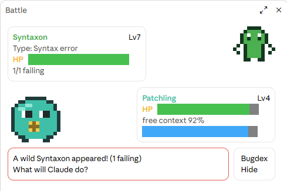
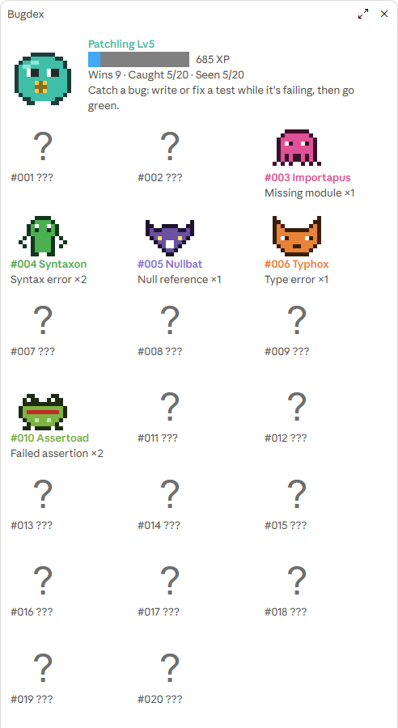
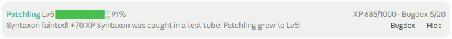
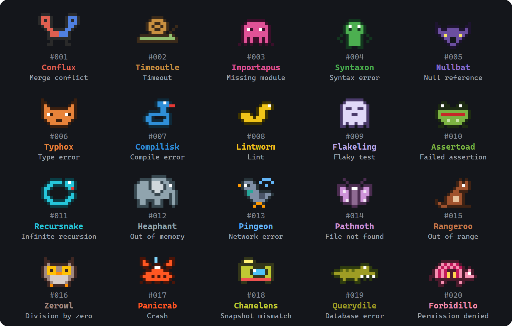
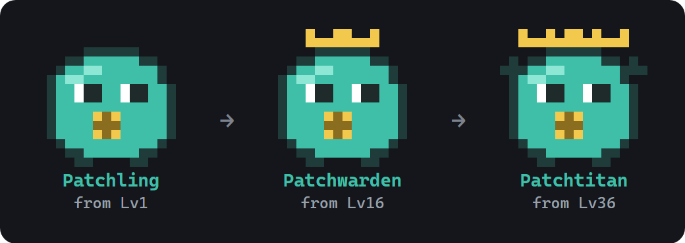

# Bugdex

**Your coding agent fights the bugs. You catch them.**

Bugdex is a mod for [Claude Code](https://code.claude.com) that turns an ordinary coding session into a monster-battle game. A failing test run summons a wild bug, every run with fewer failures lands a hit, and a green suite makes the bug faint. If a test was written or fixed during the fight, the bug is caught and goes into your Bugdex.

Nothing about the work changes. Claude reads the same files, runs the same tests and lands the same fixes. Bugdex only watches what happens and draws it as a fight, both in the terminal and in the desktop app.

<p align="center">
  
</p>

## Contents

- [How a session plays](#how-a-session-plays)
- [In the terminal and in the desktop app](#in-the-terminal-and-in-the-desktop-app)
- [The Bugdex](#the-bugdex)
- [Your creature](#your-creature)
- [How a fight works](#how-a-fight-works)
- [Fair play](#fair-play)
- [Commands](#commands)
- [Install](#install)
- [Try it on the demo project](#try-it-on-the-demo-project)
- [Supported runners](#supported-runners)
- [Troubleshooting](#troubleshooting)
- [Privacy and cost](#privacy-and-cost)
- [Develop](#develop)
- [Roadmap](#roadmap)
- [License and disclaimer](#license-and-disclaimer)

## How a session plays

| In your session | In Bugdex |
| --- | --- |
| A test, lint, build or merge fails | A **wild bug appears**. Its species comes from the error: a `TypeError` is a Typhox, a missing module an Importapus |
| The number of failures | The bug's HP and level |
| Free context window | Your creature's HP |
| A run with fewer failures | A hit: the bug's HP drops |
| The suite goes green | The bug **faints** and you earn XP |
| A test was written or fixed during the fight | The bug is **caught** and added to your **Bugdex** |
| Green again with nothing changed | It was a **Flakeling** all along: a flaky test |
| The same file edited 3+ times with no progress | Your creature is **Confused**. Time to step in |
| A permission prompt | A wild encounter. Display only: you still decide in the normal dialog |

Your level, XP, wins and Bugdex carry over from one session to the next. A new session starts with full HP because its context is still empty.

## In the terminal and in the desktop app

Bugdex draws in three places:

- **The band**, two lines above the prompt. It shows the bug you're fighting and your creature's HP, or your XP and Bugdex count when all is quiet. It has a **Battle** button during a fight, plus **Bugdex** and **Hide** buttons.
- **The battle pane** shows the fight: the bug and its card at the top, your creature and its card below, and the fight's messages at the bottom.
- **The Bugdex pane** shows your creature, your level, XP and wins, and every species you've seen or caught.

A win also shows a short toast with the XP earned, a catch, a level-up or an evolution.

### Terminal

Creatures are pixel art drawn with half-block characters, two pixels per character cell, in 24-bit color.

<p align="center">
  
</p>

<p align="center">
  
</p>

### Desktop app

The desktop app draws the same pixel art as SVG, and the HP and XP bars are drawn as boxes so they always fit their cards.

<table>
  <tr>
    <td width="50%" valign="top"></td>
    <td width="50%" valign="top"></td>
  </tr>
</table>

Once Claude fixed the syntax error and added a regression test, the bug fainted and was caught. The band reported the result:

<p align="center">
  
</p>

| | Terminal | Desktop app |
| --- | --- | --- |
| Creatures | Half-block pixel art | The same pixels as SVG |
| Battle pane | Opens by itself when a bug appears and the terminal is at least 144 columns wide. On a narrower terminal, press **Battle** on the band | Opens by itself when a bug appears |
| Bugdex pane | `/bugdex` | `/bugdex` |

When a fight is over, the battle pane closes as soon as you send your next prompt.

## The Bugdex

<p align="center">
  
</p>

| No. | Species | Type | Appears on |
| --- | --- | --- | --- |
| #001 | Conflux | Merge conflict | `CONFLICT (content)`, `Automatic merge failed` |
| #002 | Timeoutle | Timeout | `timed out`, `Exceeded timeout of 5000 ms` |
| #003 | Importapus | Missing module | `Cannot find module`, `ModuleNotFoundError`, `ImportError` |
| #004 | Syntaxon | Syntax error | `SyntaxError`, `Unexpected token`, `IndentationError` |
| #005 | Nullbat | Null reference | `Cannot read properties of undefined`, `NullPointerException`, `'NoneType' object` |
| #006 | Typhox | Type error | `TypeError`, `is not assignable to` |
| #007 | Compilisk | Compile error | `error TS2322`, `error[E0308]`, any other failed build |
| #008 | Lintworm | Lint | Any failed lint run |
| #009 | Flakeling | Flaky test | A suite that goes green with nothing changed |
| #010 | Assertoad | Failed assertion | Any other failed test |
| #011 | Recursnake | Infinite recursion | `Maximum call stack size exceeded`, `RecursionError` |
| #012 | Heaphant | Out of memory | `JavaScript heap out of memory`, `MemoryError`, `OutOfMemoryError` |
| #013 | Pingeon | Network error | `ECONNREFUSED`, `fetch failed`, `ConnectionError` |
| #014 | Pathmoth | File not found | `ENOENT`, `FileNotFoundError`, `No such file or directory` |
| #015 | Rangeroo | Out of range | `IndexError`, `KeyError`, `RangeError`, `index out of range` |
| #016 | Zerowl | Division by zero | `ZeroDivisionError`, `division by zero` |
| #017 | Panicrab | Crash | Rust and Go panics, `Segmentation fault` |
| #018 | Chamelens | Snapshot mismatch | Jest and Vitest snapshot failures |
| #019 | Querydile | Database error | `psycopg2.errors`, `IntegrityError`, a violated constraint |
| #020 | Forbidillo | Permission denied | `EACCES`, `PermissionError`, Odoo's `AccessError` |

The first species whose pattern matches the output wins, and the more specific ones are checked first. Node's `fetch failed` is technically a `TypeError`, but it summons a Pingeon. A Go panic on `index out of range` is a Rangeroo, and a Rust panic on `attempt to divide by zero` is a Zerowl. Only a panic that no other species claims is a Panicrab.

In the Bugdex pane, a caught species is drawn in color, a species you've seen but not caught is a gray silhouette, and a species you haven't met yet is a question mark.

## Your creature

<p align="center">
  
</p>

Your creature grows with XP. **Patchling** evolves into **Patchwarden** at Lv16 and into **Patchtitan** at Lv36.

- **XP for a win:** 30, plus 15 for every failure at the fight's peak, plus 25 if the bug was caught. Unmasking a Flakeling earns a flat 10.
- **Levels:** reaching level *L* takes 40 × (*L* − 1)² XP in total. That's 640 XP for Lv5, 9,000 for Lv16 and 49,000 for Lv36. The cap is Lv100.
- **HP:** your creature's HP is the share of the context window that's still free.

For example, the Syntaxon in the screenshots had one failure and was caught: 30 + 15 + 25 = 70 XP. That took Patchling from 615 to 685 XP, past the 640 needed for Lv5.

## How a fight works

1. **A bug appears** when Claude runs a test, lint, build or git command that fails. A run fails if it exits with an error or its output reports failures; a git run fails if it reports a conflict. The bug's HP is the number of failures, and its level is 4 + 3 × that number, up to Lv99.
2. **Every run of the same kind is a turn.** With fewer failures it's a hit and the bug's HP drops. With the same number or more, the bug shrugs it off.
3. **Edits are tracked per file.** Bugdex counts a file as a test if it sits in `test/`, `tests/`, `__tests__/`, `spec/` or `specs/`, or is named like `*.test.*`, `*.spec.*`, `test_*.py`, `*_test.go` or `*_test.py`.
4. **Confusion:** if one file has been edited three or more times and the next run makes no progress, your creature is Confused. That's a hint that Claude is going in circles.
5. **The bug faints** on a clean run of the same kind: the exit code is 0 and no failures are reported. You earn XP, and your creature levels up or evolves when the XP is enough.
6. **Caught:** the bug goes into your Bugdex only if a test file was edited during the fight. If nothing at all was edited, the bug turns out to have been a Flakeling.

Each kind of check fights its own bug. Tests, lint, builds and git conflicts never end each other's battles. Commands run in the background and interrupted runs are ignored.

A permission prompt is drawn as an encounter: "A wild Bash appeared!". If you approve, you let it through; if you deny, it flees. It's only a picture: the decision stays in Claude Code's own dialog.

## Fair play

A game that rewards bad habits does harm, so the rules are built against gaming them:

- XP only comes from a suite that was **red first and then went green**. A green run with no fight earns nothing.
- A bug counts as **caught** only if a test file was written or edited **during** the fight, before the suite went green.
- Green without any change is a flaky test, not a win. It earns a token 10 XP and the Flakeling entry.
- A lint pass never ends a test battle; each kind of check fights its own bugs.
- Losing costs nothing. If your context fills up, you simply miss out on a clean win.

## Commands

| Command | Does |
| --- | --- |
| `/bugdex` | Opens your Bugdex: your creature, level, XP and every species you've seen or caught |
| `/bugdex battle` | Opens the battle pane: the bug and your creature, their HP and the fight's messages |
| `/bugdex band off` | Hides the band above the prompt |
| `/bugdex band on` | Brings it back |

The band's own buttons do the same: **Battle** (during a fight), **Bugdex** and **Hide**.

## Install

Bugdex needs a Claude Code build with mods: 2.1.286 or later.

```text
/plugin marketplace add ahmtsahin/bugdex
```

```text
/plugin install bugdex@bugdex
```

To run it from a clone instead:

```bash
claude --plugin-dir path/to/bugdex
```

## Try it on the demo project

[`bugdex-demo`](bugdex-demo) is a tiny shop module tested with Node's built-in test runner. `checkout.js` ships with a planted syntax error, so the first run is red.

```bash
cd bugdex-demo
```

```bash
claude --plugin-dir ..
```

Then ask Claude to run `node --test`, fix what fails and add a regression test. A wild Syntaxon appears on the red run. The fix makes it faint, and the new test catches it. Afterwards, put the error back (`shippingCountry(cart {`) to play again.

## Supported runners

Bugdex watches the commands Claude runs through its **Bash** and **PowerShell** tools.

- **Tests:** Jest, Vitest, Mocha, AVA, pytest, unittest, PHPUnit, RSpec, Playwright, Cypress, `go test`, `cargo test`, `dotnet test`, `deno test`, `node --test`, Maven, Gradle, `make test`, Odoo's `--test-enable`, and `npm`/`pnpm`/`yarn`/`bun test`
- **Lint:** ESLint, Ruff, Flake8, Pylint, Stylelint, golangci-lint, Clippy, Biome, `npm run lint`
- **Build and types:** `tsc`, mypy, Pyright, `cargo build`/`check`, `go build`/`vet`, `npm run build`/`typecheck`
- **Git:** conflicts from `merge`, `rebase`, `pull` and `cherry-pick`

Failure counts are read the way these runners print them, for example `Tests: 2 failed`, `=== 3 failed in 2.1s ===`, `1 failing`, `FAILED (failures=2)`, `--- FAIL`, `# fail 2`, `Found 4 errors` and `5 problems`.

Missing yours? Command detection and failure counting live in `hooks/game.ts` (`kindOf`, `countFailed`). A pull request that includes a test with the runner's real output is welcome; see [CONTRIBUTING.md](CONTRIBUTING.md).

## Troubleshooting

| You see | Why, and what to do |
| --- | --- |
| A test fails, but no bug appears | Bugdex only sees commands Claude runs through its Bash or PowerShell tool, and only the runners listed above. Runs in the background are skipped |
| A bug appears, but the battle pane doesn't open | The terminal is narrower than 144 columns. Press **Battle** on the band or run `/bugdex battle` |
| The band is gone | It was hidden. Run `/bugdex band on` |
| A green run gave only 10 XP | Nothing was edited during the fight, so it counted as a flaky test |
| The bug fainted but wasn't caught | No test file changed during the fight. Write or fix a test while the suite is still red |

## Privacy and cost

- Everything stays on your machine. Your progress lives in Claude Code's own plugin store under `~/.claude/plugins/store/`. Bugdex makes **no network requests**.
- Bugdex makes **no model calls**, so it costs no tokens.
- It reads tool calls and their output only to recognize test runs and edits. It never changes a tool call, a result, a prompt or a permission decision.

## Develop

```bash
claude --plugin-dir .
```

```bash
claude plugin validate .
```

```bash
claude plugin test .
```

Run `/plugin-types` inside a session to write the type declarations your editor needs into `.claude/types`; the `tsconfig.json` here picks them up.

| Path | What's in it |
| --- | --- |
| `hooks/game.ts` | The rules, with no `$` in them: command detection, failure counting, battle steps, XP and levels |
| `hooks/species.ts` | The species with their patterns and sprites, and your creature's three forms |
| `hooks/raster.ts` | Turns a sprite into terminal cells (half blocks) or SVG |
| `hooks/register.tsx` | The hooks: tool calls, the `/bugdex` command, the band and both panes |
| `hooks/game.test.ts` | The tests run by `claude plugin test` |
| `types/index.d.ts` | The contract for the values Bugdex keeps in `$.state` |
| `bugdex-demo/` | A small project with a planted bug to try Bugdex on |
| `docs/images/` | The images in this README |

To add a species or support another runner, see [CONTRIBUTING.md](CONTRIBUTING.md).

## Roadmap

- Evolutions for caught bugs that stay fixed
- Badges per repository (types, tests, lint, CI, review, merge) and daily quests
- A shareable trainer card
- Evolution branches decided by how you work (tests, refactors, debugging, delegation)
- Rare "shiny" bugs
- Syncing progress between machines

## License and disclaimer

[MIT](LICENSE). Every creature, name and sprite in Bugdex is original.

Bugdex is an unofficial community mod. It is not affiliated with, endorsed by or sponsored by Anthropic.
